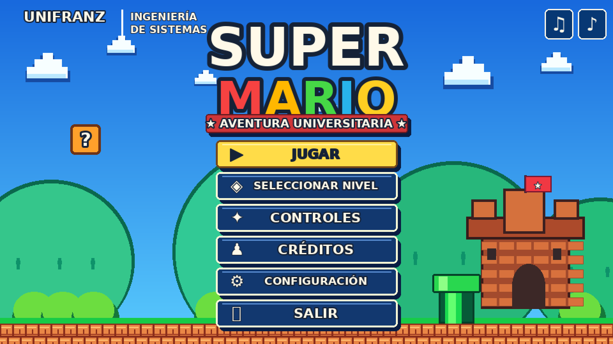
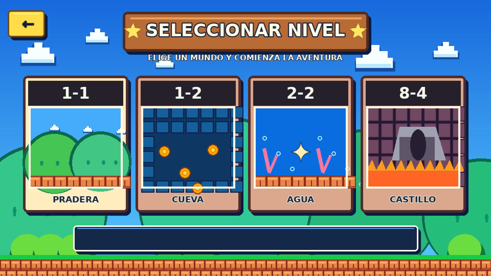
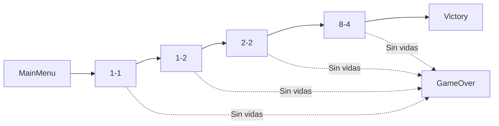
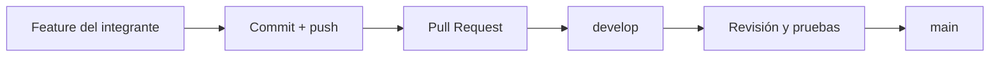

<div align="center">

# 🍄 SUPER MARIO BROS 2D
### Aventura universitaria · Hito 4

**Proyecto grupal de Multimedia y Videojuegos · Ingeniería de Sistemas · UNIFRANZ La Paz · 2026**

**Unity 6 (6000.3.16f1)** · **C#** · **Pixel art 2D** · **4 integrantes** · **7 escenas en `main`**

[🎮 Ver el menú](#-menú-interactivo) · [👥 Equipo y GitHub](#-equipo-y-aportaciones) · [✅ Consigna del docente](#-requisitos-del-hito-4) · [💻 Ejecutar](#-abrir-el-proyecto) · [📚 Créditos](#-créditos-y-procedencia)

</div>

> [!NOTE]
> **Estado de referencia:** revisión de la rama [`main`](https://github.com/vicentesystemdev/SuperMarioVicente/tree/main) hasta el commit [`39d05203`](https://github.com/vicentesystemdev/SuperMarioVicente/commit/39d05203), el **5 de noviembre de 2026**. La existencia de escenas y scripts en GitHub confirma su incorporación al código, **no reemplaza las pruebas manuales en Unity o Windows**. Las mejoras particulares de Marcelo en `develop-marcelo` se distinguen de las ya integradas en `main`.

## 📖 Sobre el proyecto

Partimos del repositorio público facilitado en la materia para ampliar un juego de plataformas 2D inspirado en *Super Mario Bros.*. Primero se adaptó la base a **Unity 6** y se añadieron niveles y pantallas; posteriormente, el equipo trabajó las mejoras del **Hito 4: SUPER MARIO MANUAL**: menú interactivo, música ambiental, efectos sonoros y contadores de juego.

- **Fork utilizado por el equipo:** [`vicentesystemdev/SuperMarioVicente`](https://github.com/vicentesystemdev/SuperMarioVicente)
- **Repositorio proporcionado:** [`Jesusbautistah/SUPER-MArio`](https://github.com/Jesusbautistah/SUPER-MArio)
- **Tutorial técnico de referencia:** [`zigurous/unity-super-mario-tutorial`](https://github.com/zigurous/unity-super-mario-tutorial)
- **Plataforma de desarrollo y compilación:** Unity 6; compilación prevista para Windows x64.

## ✅ Requisitos del Hito 4

| Lo solicitado por el docente | Evidencia existente en `main` | Estado de verificación |
|---|---|---|
| Fork público grupal | Repositorio público del equipo, con ramas, colaboradores y commits. | **Disponible** |
| Escena inicial de menú interactivo | [`MainMenu.unity`](Assets/Scenes/MainMenu.unity), [`Hito4MenuController.cs`](Assets/Hito4PixelUI/Scripts/Hito4MenuController.cs); menú en índice 0 del build. | **Código integrado**; probar opciones en Unity |
| Sonido ambiente | [`LevelMusic.cs`](Assets/Scripts/LevelMusic.cs), [`MarioAudio.cs`](Assets/Scripts/MarioAudio.cs), recursos de audio y ajustes. | **Código y recursos presentes**; escuchar en los niveles |
| SFX: salto, pisotón, power-up, daño y muerte | [`Sfx.cs`](Assets/Scripts/Sfx.cs), [`ChiptuneSynth.cs`](Assets/Scripts/ChiptuneSynth.cs) y llamadas desde los eventos del juego. | **Implementación localizada**; probar los cinco eventos |
| Tiempo restante | [`GameManager.cs`](Assets/Scripts/GameManager.cs), [`LevelSettings.cs`](Assets/Scripts/LevelSettings.cs) y [`GameHud.cs`](Assets/Scripts/GameHud.cs). | **Código integrado**; verificar cuenta regresiva |
| Puntaje por monedas y enemigos | Suma de puntos en `GameManager`, `Goomba`, `Koopa`, `WaterEnemy` y otros eventos. | **Código integrado**; verificar cantidades y no duplicación |
| Contador de monedas | `GameManager.AddCoin()` y columna de monedas en `GameHud`. | **Código integrado**; verificar actualización |

> [!IMPORTANT]
> El ejemplo del docente ilustra un menú clásico con opciones para iniciar el juego. **Nuestra implementación usa un menú ampliado** con Jugar, selección de mundos, Controles, Créditos y Ajustes. Las opciones **Jugar** y las tarjetas de nivel inician partidas; las otras opciones abren sus respectivas pantallas. Corresponde al equipo confirmar con el docente si exige reproducir exactamente las dos opciones de la imagen de referencia.

## 🎮 Menú interactivo

<div align="center">
<table>
<tr>
<td width="50%" align="center"><br /><sub>Menú principal</sub></td>
<td width="50%" align="center"><br /><sub>Selección de mundos</sub></td>
</tr>
</table>
<sub>Estas imágenes son **recursos gráficos incluidos en el proyecto**, no capturas de una partida ejecutándose.</sub>
</div>

El trabajo de **Víctor** está incorporado a la rama `main` y utiliza [`Assets/Hito4PixelUI/`](Assets/Hito4PixelUI/) y `Assets/Scenes/MainMenu.unity`.

**Opciones implementadas en código:** Jugar, selección de `1-1` / `1-2` / `2-2` / `8-4`, Controles, Créditos, Ajustes de música y SFX, control de volumen, salida del juego y pausa con **Esc** o **P** (Continuar, Reiniciar o Menú). Las preferencias de audio se guardan con `PlayerPrefs`.

## 🌍 Mundos y pantallas

| Escena en `main` | Descripción | Contexto del desarrollo |
|---|---|---|
| [`MainMenu`](Assets/Scenes/MainMenu.unity) | Inicio, navegación y ajustes. | Mejoras grupales de **Víctor**. |
| [`1-1`](Assets/Scenes/1-1.unity) | Pradera: plataformas, bloques, monedas y enemigos. | Nivel base y ajustes de integración. |
| [`1-2`](Assets/Scenes/1-2.unity) | Zona subterránea, enemigos, tuberías y salida. | Ampliación previa a la etapa grupal. |
| [`2-2`](Assets/Scenes/2-2.unity) | Agua, natación, criaturas y obstáculos acuáticos. | Base previa, después mejorada por **Carla**. |
| [`8-4`](Assets/Scenes/8-4.unity) | Castillo, trampas, lava y enfrentamiento final. | **Base presente en `main`**; mejoras grupales de **Marcelo** en rama separada. |
| [`GameOver`](Assets/Scenes/GameOver.unity) | Resultado de perder todas las vidas. | Sistema base de vidas previo a la etapa grupal. |
| [`Victory`](Assets/Scenes/Victory.unity) | Pantalla de victoria final. | Escena base previa a la etapa grupal. |



<sub>El diagrama representa la **ruta de juego prevista**. La conectividad de todas las tuberías, banderas, menús y pantallas debe comprobarse jugando la secuencia completa.</sub>

## 👥 Equipo y aportaciones

La siguiente tabla relaciona los **nombres del grupo** con los **usuarios que figuran en el historial de commits de GitHub**. La asignación de un módulo y la incorporación efectiva a `main` no son necesariamente lo mismo.

| Integrante | Usuario de GitHub | Responsabilidad y aportes | Situación respecto a `main` |
|---|---|---|---|
| **Marcelo Josué Escobar Chipana** | [**@Josue-EC16**](https://github.com/Josue-EC16) | Castillo `8-4`: jefe, velocidad, plataformas, colisiones y música del nivel. | Castillo base en `main`; **mejoras propias en `develop-marcelo`**. |
| **Víctor Grover Asturizaga Plata** | [**@Developer-vic1**](https://github.com/Developer-vic1) | Menú interactivo, selector de niveles, controles, créditos, ajustes, pausa, audio y correcciones de `1-1`. | **Aportes incorporados en `main`**. |
| **Vicente Óscar Claros Mamani** | [**@vicentesystemdev**](https://github.com/vicentesystemdev) | HUD (puntos, monedas, mundo, tiempo), lógica de puntuación, pantalla intermedia de vidas y fanfarria de bandera; integración general. | **Aportes incorporados en `main`**. |
| **Carla Valeria Encinas Cano** | [**@VarlaCdev20**](https://github.com/VarlaCdev20) | Mejoras acuáticas `2-2`: natación, enemigos, corrientes, música dinámica y compatibilidad con el HUD. | **Aportes incorporados en `main`**. |

<details>
<summary><strong>🎮 Víctor — Menú, interfaz y sonido</strong></summary>

- Integró el paquete de interfaz [`Assets/Hito4PixelUI/`](Assets/Hito4PixelUI/), con imágenes, controlador del menú y menú de pausa.
- Implementó navegación por pantallas, inicio de partida en los cuatro mundos y preferencias persistentes de música, SFX y volumen.
- Integró recursos de sonido y realizó correcciones de colisión en `1-1`.
- **Archivos principales:** [`Hito4MenuController.cs`](Assets/Hito4PixelUI/Scripts/Hito4MenuController.cs), [`Hito4PauseController.cs`](Assets/Hito4PixelUI/Scripts/Hito4PauseController.cs), [`Hito4AudioSettings.cs`](Assets/Hito4PixelUI/Scripts/Hito4AudioSettings.cs), [`MainMenu.unity`](Assets/Scenes/MainMenu.unity), [`MarioAudio.cs`](Assets/Scripts/MarioAudio.cs).
- **Evidencia de commits:** [`85360ecd` — menú completado, sonidos y UI](https://github.com/vicentesystemdev/SuperMarioVicente/commit/85360ecd) y [`bab1b883` — incorporación de sonidos](https://github.com/vicentesystemdev/SuperMarioVicente/commit/bab1b883).

</details>

<details>
<summary><strong>🌊 Carla — Nivel acuático 2-2</strong></summary>

- Mejoró la dinámica de nado, fauna submarina, obstáculos y longitud/distribución del nivel.
- Añadió ajustes de música acuática, enemigos adicionales, corrientes e interacción con indicadores de puntos y monedas.
- **Archivos representativos:** [`AplicarMejorasCarlaAcuatico.cs`](Assets/Editor/AplicarMejorasCarlaAcuatico.cs), [`WaterZone.cs`](Assets/Scripts/WaterZone.cs), [`WaterEnemy.cs`](Assets/Scripts/WaterEnemy.cs), [`MusicaAcuaticaDinamica.cs`](Assets/Scripts/MusicaAcuaticaDinamica.cs) y [`2-2.unity`](Assets/Scenes/2-2.unity).
- **Evidencia:** [`66527835` — mejorar nivel acuático](https://github.com/vicentesystemdev/SuperMarioVicente/commit/66527835), [`b7bbe165` — música dinámica](https://github.com/vicentesystemdev/SuperMarioVicente/commit/b7bbe165), [PR #4 — integración a main](https://github.com/vicentesystemdev/SuperMarioVicente/pull/4).

</details>

<details>
<summary><strong>🧮 Vicente — HUD, puntuación, vidas y audio de bandera</strong></summary>

- Implementó el **HUD persistente** con puntuación, monedas, mundo y temporizador visible.
- Incorporó puntos por monedas y enemigos, temporizador de nivel, bonificación por tiempo y protección frente a puntuaciones duplicadas en eventos tratados.
- Añadió una **pantalla intermedia** con las vidas restantes cuando Mario muere, antes de reiniciar el nivel. Con cero vidas se carga `GameOver`.
- Mejoró la secuencia de bandera: efecto al tocar el mástil, descenso, **fanfarria de nivel completado** y transición siguiente. Esta fanfarria **no equivale a la música de la escena `Victory`**.
- **Archivos principales:** [`GameHud.cs`](Assets/Scripts/GameHud.cs), [`GameManager.cs`](Assets/Scripts/GameManager.cs), [`LevelSettings.cs`](Assets/Scripts/LevelSettings.cs), [`LivesScreen.cs`](Assets/Scripts/LivesScreen.cs), [`FlagPole.cs`](Assets/Scripts/FlagPole.cs), [`ChiptuneSynth.cs`](Assets/Scripts/ChiptuneSynth.cs).
- **Documentación:** [`Hito4_HUD_Vicente.md`](Docs/Hito4_HUD_Vicente.md), [`Hito4_Vidas_Y_Audio_Vicente.md`](Docs/Hito4_Vidas_Y_Audio_Vicente.md).
- **Evidencia:** [PR #2 — HUD, puntuación y tiempo](https://github.com/vicentesystemdev/SuperMarioVicente/pull/2), [PR #3 — vidas y fanfarria](https://github.com/vicentesystemdev/SuperMarioVicente/pull/3).

**Trabajo previo al Hito 4 grupal:** Vicente preparó la migración a Unity 6 y las primeras versiones de las escenas adicionales, el sistema GameOver y el castillo base. Estas contribuciones iniciales no deben confundirse con las mejoras de los demás estudiantes sobre esos sistemas.

</details>

<details>
<summary><strong>🏰 Marcelo — Mejoras del castillo 8-4</strong></summary>

- Desarrolló en su rama ajustes de movimiento/velocidad, colisiones, plataformas, comportamiento del jefe y música del nivel final.
- **Rama de trabajo encontrada:** [`develop-marcelo`](https://github.com/vicentesystemdev/SuperMarioVicente/tree/develop-marcelo).
- **Commits de referencia:** [`23a28a24` — velocidad y colisiones](https://github.com/vicentesystemdev/SuperMarioVicente/commit/23a28a24), [`78c9eff4` — música integrada en escena](https://github.com/vicentesystemdev/SuperMarioVicente/commit/78c9eff4).
- **Estado:** el castillo base `8-4` ya está en `main`, pero **no se han identificado esos commits de Marcelo como integrados en `main`** en esta revisión. Se deben fusionar y probar antes de presentarlos como parte de la versión principal.

</details>

## 🧮 HUD, vidas y puntuación

En [`GameManager.cs`](Assets/Scripts/GameManager.cs) existen los siguientes valores de puntuación:

| Acción | Puntos definidos |
|---|---:|
| Moneda | 200 |
| Pisotón | 100 |
| Enemigo eliminado | 200 |
| Power-up | 1.000 |
| Jefe final | 5.000 |
| Cada unidad de tiempo restante al completar nivel | 50 |

- La partida comienza con **3 vidas**.
- El tiempo por defecto es **400 unidades**, configurable por escena en `LevelSettings`.
- El HUD se crea en tiempo de ejecución y se mantiene entre escenas mediante `GameManager`.
- Al recoger **100 monedas**, el contador se reinicia y se suma una vida extra.
- La pantalla de vidas se muestra entre intentos; `GameOver` se utiliza al agotar las vidas.

## 🔊 Audio y efectos

El proyecto combina música y clips importados en [`Assets/Resources/MarioAudio/`](Assets/Resources/MarioAudio/) con efectos generados mediante [`ChiptuneSynth.cs`](Assets/Scripts/ChiptuneSynth.cs). Los puntos de reproducción están repartidos entre los scripts de jugador, enemigos, elementos, nivel y menú.

| Evento requerido | Referencia de implementación | Comprobación de entrega |
|---|---|---|
| Ambiente | `LevelMusic`, `MarioAudio`, ajustes del menú | Escuchar entrada y cambio de nivel |
| Salto | `ChiptuneSynth.Jump` | Saltar en `1-1` |
| Pisotón | `ChiptuneSynth.Stomp` | Derrotar Goomba saltando |
| Power-up | `ChiptuneSynth.PowerUpCollect` | Recoger un champiñón |
| Daño | `Player.Shrink()` → `ChiptuneSynth.Damage` | Recibir golpe con Mario grande |
| Muerte | `GameManager.ResetLevel()` → `DeathJingle` | Perder una vida |
| Bandera / final de nivel | `FlagPole` → `FlagTouch`, `Flag`, `LevelClear` | Completar un nivel con bandera |

> **Nota de atribución de audio:** hay archivos MP3 importados al proyecto y efectos sintetizados. No se afirma que todos sean composiciones originales del equipo. Se debe comprobar el origen y los permisos de cada pista antes de redistribuir materiales protegidos.

## 🎮 Controles

| Acción | Control |
|---|---|
| Caminar | `A` / `D` o flechas izquierda/derecha |
| Saltar | `Espacio` |
| Nadar | Pulsaciones sucesivas de `Espacio` dentro del agua |
| Tubería vertical | `S`, donde esté habilitada |
| Entrada lateral | `D`, donde esté habilitada |
| Menú | Ratón, flechas y confirmación con teclado |
| Volver de una pantalla del menú | `Esc` o botón correspondiente |
| Pausar / reanudar | `Esc` o `P` durante el nivel |

## 💻 Abrir el proyecto

**Requisitos:** Unity Hub, **Unity Editor 6000.3.16f1** y Git. Para exportar a Windows, disponer del soporte de compilación correspondiente.

```powershell
git clone https://github.com/vicentesystemdev/SuperMarioVicente.git
cd SuperMarioVicente
git switch main
```

1. En Unity Hub, selecciona **Add project from disk** y abre la carpeta clonada.
2. Comprueba que se utiliza Unity **6000.3.16f1**. Deja terminar la importación de paquetes, incluido **Unity UI (uGUI)**.
3. Abre **File → Build Profiles → Scene List**. La lista ya registrada en `main` comienza por `MainMenu`, seguido de `1-1`, `GameOver`, `1-2`, `2-2`, `8-4` y `Victory`.
4. Abre [`MainMenu.unity`](Assets/Scenes/MainMenu.unity), pulsa **Play** y verifica las opciones del menú.
5. Para un ejecutable Windows x64: **File → Build Profiles → Windows → Build**; conserva el `.exe`, su carpeta `*_Data` y los archivos complementarios. **El ejecutable debe probarse fuera de Unity.**

**No regeneres el menú ni los niveles sin necesidad:** las escenas ya están en el repositorio y los generadores pueden modificar contenido existente.

## 🌿 Flujo de colaboración con Git

- [`main`](https://github.com/vicentesystemdev/SuperMarioVicente/tree/main): rama principal que se revisa para la entrega.
- [`develop`](https://github.com/vicentesystemdev/SuperMarioVicente/tree/develop): integración de trabajo grupal.
- `feature/*` y otras ramas de integrante: desarrollo de cambios antes de fusionarlos.



Para comprobar la autoría y el trabajo compartido, consulta [los commits de `main`](https://github.com/vicentesystemdev/SuperMarioVicente/commits/main/), [las ramas](https://github.com/vicentesystemdev/SuperMarioVicente/branches) y [los Pull Requests](https://github.com/vicentesystemdev/SuperMarioVicente/pulls?q=is%3Apr+is%3Amerged).

## 📝 Evidencia individual para el foro

El docente solicita una **publicación por estudiante**, además del trabajo grupal. Cada publicación debe incluir:

- [ ] Una descripción breve de las funcionalidades realmente agregadas al fork.
- [ ] Una dificultad técnica encontrada durante la implementación.
- [ ] La característica favorita y por qué fue interesante desarrollarla.
- [ ] Una captura **real del juego en Unity**, coherente con la explicación.
- [ ] El enlace al [fork público del equipo](https://github.com/vicentesystemdev/SuperMarioVicente).

**La captura del foro no debe sustituirse por el arte conceptual del menú incluido más arriba.** El archivo de compilación Windows fue parte de otra evaluación; la consigna de este foro solicita enlace del fork, evidencia y explicación individual.

### Verificación final pendiente

- [ ] Abrir `MainMenu` desde el inicio y recorrer las pantallas de Víctor.
- [ ] Verificar Jugar, selección de mundos, pausa y ajustes de volumen/SFX.
- [ ] Probar saltos, pisotones, power-up, daño, muerte y ambiente.
- [ ] Confirmar que puntos, monedas y tiempo se actualizan correctamente.
- [ ] Probar pantalla de vidas y `GameOver` hasta agotar las tres vidas.
- [ ] Revisar banderas, tuberías y transiciones de los cuatro mundos.
- [ ] Validar la integración del castillo actualizado de Marcelo cuando se fusione.
- [ ] Completar una partida y verificar `Victory`.
- [ ] Capturar evidencias reales y, si se entrega ejecutable, probar Windows x64.

## 📚 Documentación técnica

| Documento | Contenido |
|---|---|
| [`Hito4_HUD_Vicente.md`](Docs/Hito4_HUD_Vicente.md) | HUD, puntuación y temporizador |
| [`Hito4_Vidas_Y_Audio_Vicente.md`](Docs/Hito4_Vidas_Y_Audio_Vicente.md) | Pantalla de vidas y fanfarria de bandera |
| [`Mejora1_NivelSubterraneo.md`](Docs/Mejora1_NivelSubterraneo.md) | Nivel `1-2` |
| [`Mejora2_NivelAcuatico.md`](Docs/Mejora2_NivelAcuatico.md) | Base del nivel `2-2` |
| [`Mejora3_GameOver.md`](Docs/Mejora3_GameOver.md) | Sistema inicial de vidas y GameOver |
| [`Mejora4_CastilloBowser.md`](Docs/Mejora4_CastilloBowser.md) | Base del castillo final |
| [`Assets/Hito4PixelUI/README.md`](Assets/Hito4PixelUI/README.md) | Menú y pausa integrados por Víctor |

## ©️ Créditos y procedencia

- **Nintendo y respectivos titulares:** *Super Mario Bros.*, Mario, Bowser, marcas, personajes, diseños y materiales originales asociados.
- **[Zigurous](https://github.com/zigurous/unity-super-mario-tutorial):** tutorial y base técnica de Unity a partir de la cual procede el proyecto.
- **[Jesusbautistah](https://github.com/Jesusbautistah/SUPER-MArio):** repositorio público compartido como punto de partida de la actividad.
- **Equipo UNIFRANZ:** ampliaciones y mejoras académicas de [Marcelo](https://github.com/Josue-EC16), [Víctor](https://github.com/Developer-vic1), [Vicente](https://github.com/vicentesystemdev) y [Carla](https://github.com/VarlaCdev20), según su historial y ramas de trabajo.
- **Herramientas de asistencia:** se utilizó Claude Code como apoyo al desarrollo y a la documentación; los estudiantes son responsables de comprobar los resultados y presentar sus contribuciones.

**Este es un proyecto académico no oficial y no comercial.** El hecho de que los repositorios sean públicos o que se reconozca a sus autores no concede por sí mismo una licencia para reutilizar o redistribuir contenido de terceros. No se declara una licencia general para los recursos del juego.

---

<div align="center">

**4 integrantes · 4 mundos · Un proyecto colaborativo**

[↑ Volver al inicio](#-super-mario-bros-2d) · [Repositorio GitHub](https://github.com/vicentesystemdev/SuperMarioVicente)

</div>
