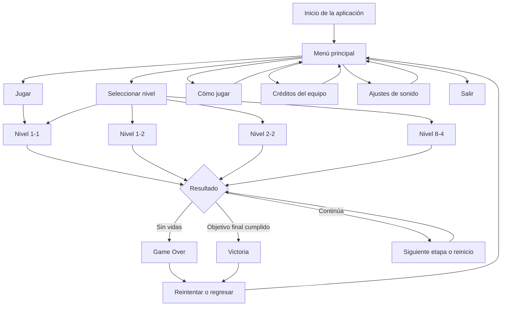
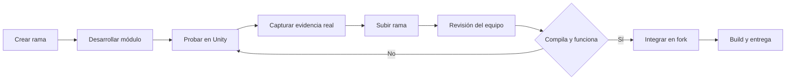

SUPER MARIO BROS 2D
AVENTURA UNIVERSITARIA
Proyecto grupal de Multimedia y Videojuegos | Hito 4 | UNIFRANZ La Paz | 2026

UNITY 6   C#   PIXEL ART 2D   GIT / GITHUB   4 INTEGRANTES

Cuatro responsabilidades, varios mundos y una experiencia de principio a fin.

Empezar · Explorar mundos · Conocer al equipo · Instalar · Ver pruebas

Secuencia animada elaborada para esta documentación. Es una visualización conceptual del flujo, no una grabación de Unity ni evidencia de funcionalidades ya probadas.

Estado del proyecto: integración grupal en desarrollo. En el repositorio técnico consultado ya aparecen las escenas 1-1, 1-2, 2-2, 8-4, GameOver y Victory. La escena inicial MenuPrincipal y las verificaciones completas de HUD, puntuación, tiempo y SFX siguen sujetas a integración y pruebas. Los apartados de este README separan código existente, trabajo asignado y pruebas pendientes.

01 · Comienza aquí
Este proyecto amplía una base pública de plataformas 2D inspirada en Super Mario Bros. Nuestro propósito en el Hito 4 es convertirla en una experiencia más completa y entendible: una entrada visual atractiva, niveles distintos, controles claros, sonido coherente, un sistema de vidas y una conclusión que el jugador pueda reconocer.
Tu recorrido en 6 pasos
Paso	Como jugador…	Lo que debe ocurrir
01	Abres el juego.	Aparece un menú principal legible y navegable.
02	Pulsas Jugar o Elegir nivel.	Comienza 1-1 o puedes seleccionar uno de los cuatro mundos.
03	Exploras, recoges monedas y superas enemigos.	La partida responde a controles, colisiones y efectos de audio.
04	Entras en un escenario diferente.	Cambian entorno, obstáculos y música; en 2-2 puedes nadar.
05	Pierdes todas las vidas o alcanzas el final.	Se muestra GameOver o Victory según el resultado.
06	Decides volver a intentar.	Regresas a la partida o al menú, según la opción implementada.

Importante: esta es la secuencia objetivo de la experiencia completa. El selector de niveles permitiría acceder directamente a un mundo; no obliga a jugarlos en orden.
Navegación rápida por este README
01 · Visión general / 02 · Recorrido / 03 · Mundos / 04 · Sistemas / 05 · Equipo / 06 · Interfaz / 07 · Estructura / 08 · Instalación / 09 · Git / 10 · Entrega / 11 · Créditos

02 · Flujo de pantallas y transiciones
Este diagrama muestra qué pantalla debería conducir a cuál. Se puede ampliar desde la vista de GitHub y funciona como mapa de integración, no como certificado de que todas las transiciones ya están conectadas.

Descubre cada pantalla

<strong>01 — MENÚ PRINCIPAL · Punto de entrada</strong>
La escena objetivo Assets/Scenes/MenuPrincipal.unity se encargará de presentar el nombre del juego, animaciones de fondo, opciones claras y música ambiental.
Elemento	Comportamiento previsto
Jugar	Abre el nivel 1-1.
Seleccionar nivel	Muestra las tarjetas de 1-1, 1-2, 2-2 y 8-4.
Cómo jugar	Explica movimiento, salto, natación y objetivo.
Créditos	Presenta integrantes y responsabilidades.
Sonido	Permite ajustar o activar/desactivar el sonido, según lo implementado.
Salir	Cierra la aplicación compilada.

Responsable principal: Víctor. Estado: por integrar y probar en el fork del grupo.

<strong>02 — SELECCIÓN DE NIVEL · Acceso directo a mundos</strong>

El selector debe ser una ventana real de Unity con botones y eventos OnClick, no una imagen que solamente simule botones. Cada tarjeta corresponde al nombre exacto de la escena registrada en Build Profiles.

Reglas para verificar: entrada por teclado o ratón, selección visual, carga sin errores, botón Volver y retorno correcto al menú.

<strong>03 — DURANTE LA PARTIDA · HUD y respuesta audiovisual</strong>

La pantalla de juego debe mostrar el escenario y la información necesaria sin tapar obstáculos. El Hito 4 pide tiempo restante, puntaje calculado por monedas y enemigos, y cantidad de monedas; el sistema de vidas complementa el progreso.

Reglas para verificar: cambios del contador al recoger monedas, sumar puntos, derrotar enemigos, perder una vida y agotar el tiempo, según la mecánica definida.

<strong>04 — GAME OVER · Cuando no quedan vidas</strong>

GameManager.cs inicia con tres vidas y contempla la carga de GameOver al agotarlas. La escena GameOver.unity y GameOverScreen.cs están presentes en el repositorio técnico.

Prueba recomendada: perder tres vidas de forma controlada, comprobar que no se descuenten dos veces por un mismo impacto y verificar el reinicio o salida de la pantalla.

<strong>05 — VICTORIA · Cierre y regreso</strong>

Existen Victory.unity, VictoryScreen.cs y VictoryGoal.cs; también está disponible ChiptuneSynth.VictoryTheme. El objetivo de integración es que el final del recorrido abra la pantalla de victoria, reproduzca su música y permita continuar con una opción válida.

Prueba recomendada: completar la condición final, oír la música, revisar las estadísticas y probar los botones de cierre.

03 · Los mundos
Mundo	Escenario	Experiencia	Responsable del Hito 4
1-1	Pradera	Plataformas, monedas, bloques y enemigos iniciales.	Integración grupal
1-2	Subterráneo	Rutas entre ladrillos, obstáculos y ambientación oscura.	Integración grupal
2-2	Acuático	Natación, gravedad adaptada y criaturas acuáticas.	Carla
8-4	Castillo final	Lava, peligros, trampas y desafío de cierre.	Marcelo

<strong>Ver detalles técnicos de los cuatro mundos</strong>
Mundo 1-1 — Pradera

Assets/Scenes/1-1.unity es el escenario inicial del proyecto. Permite reconocer las mecánicas clásicas de caminar, saltar, recoger monedas y enfrentar enemigos.

Mundo 1-2 — Subterráneo

Assets/Scenes/1-2.unity reutiliza componentes del juego y introduce una ambientación distinta. Se relaciona con UndergroundLevelBuilder.cs.

Mundo 2-2 — Acuático

Assets/Scenes/2-2.unity, WaterZone.cs, WaterEnemy.cs y PlayerMovement.cs contienen componentes relacionados con natación, comportamiento dentro del agua y enemigos del entorno. Carla se ocupa del trabajo grupal sobre este nivel, sus mejoras y su validación.

Mundo 8-4 — Castillo final

Assets/Scenes/8-4.unity, CastleLevelBuilder.cs, Boss.cs, BossArena.cs y los prefabs de Assets/Prefabs/Castle/ forman la base del desafío final. Marcelo desarrolla y verifica este mundo para el Hito 4.

04 · Sistemas del juego
04.1 · Audio: ambiente y efectos
El código contiene un sintetizador de sonido (ChiptuneSynth.cs), reproducción de efectos (Sfx.cs) y música por nivel (LevelMusic.cs). La presencia de estos scripts demuestra que existe una base técnica, pero cada evento solicitado debe probarse dentro del escenario correspondiente.
Acción / situación	Componente localizado	Evidencia pendiente
Salto	ChiptuneSynth.Jump	Reproducir un salto y oír el efecto.
Pisotón	ChiptuneSynth.Stomp	Derrotar un enemigo con salto.
Power-up	ChiptuneSynth.PowerUpCollect	Recoger la mejora y escuchar el evento.
Daño	Evento específico por conectar o verificar	Comprobar que suene al recibir un golpe.
Muerte	ChiptuneSynth.DeathJingle	Perder una vida.
Natación	ChiptuneSynth.Swim, WaterTheme	Entrar al agua y nadar.
Castillo	CastleTheme, BossTheme	Entrar al castillo y a la sección final.
Victoria	VictoryTheme, Fanfare	Completar el desafío final.

04.2 · Contadores y vidas
Sistema	Qué contiene actualmente el código consultado	Qué se debe completar o verificar
Vidas	GameManager.StartingLives = 3, pérdida de vidas y GameOver.	Presentación y funcionamiento sin descuentos dobles.
Monedas	GameManager.AddCoin() registra monedas y da una vida adicional por cada 100.	Mostrar las monedas recogidas en pantalla.
Puntaje	No se confirmó un sistema global de puntuación en GameManager.cs.	Sumar puntos por monedas y enemigos; actualizar el HUD.
Tiempo	No se confirmó un temporizador global en GameManager.cs.	Crear o validar cuenta regresiva y visualización.

04.3 · Controles
Acción	Controles del proyecto
Moverse	A / D o flechas izquierda / derecha.
Saltar	Espacio, mediante la acción Jump de Unity.
Nadar	Pulsaciones de Espacio dentro del agua.
Entrar en tuberías	S en entradas habilitadas; comprobar según escenario.
Navegar el menú	Ratón, flechas y Enter, cuando la escena de menú esté integrada.

No incluimos teclas de carrera o pausa como si fueran definitivas: hay que comprobar su asignación en el proyecto antes de publicarlas como controles funcionales.

05 · Quién hace qué
El trabajo es grupal, pero cada persona tiene un módulo principal y deberá explicar en el foro lo que realmente desarrolló, probó y aprendió.
Integrante	Módulo	Escenas o archivos relacionados
Marcelo Josué Escobar Chipana	Castillo final y último nivel	8-4.unity y sistemas Castle/
Víctor Grover Asturizaga Plata	Menús, música y efectos	MenuPrincipal (objetivo), Sfx.cs, ChiptuneSynth.cs
Vicente Óscar Claros Mamani	Pantalla de vidas y canciones de victoria	GameManager.cs, GameOver.unity, Victory.unity
Carla Valeria Encinas Cano	Nivel acuático	2-2.unity, WaterZone.cs, WaterEnemy.cs

<strong>Marcelo · Castillo final: desarrollo de 8-4</strong>
Propósito: construir una culminación desafiante y coherente con los niveles anteriores.

Secuencia de trabajo: 1) organizar recorrido; 2) incorporar plataformas y peligros; 3) verificar lava y colisiones; 4) conectar condición de victoria; 5) probar el recorrido completo.

Base técnica identificada: Assets/Scenes/8-4.unity, Assets/Editor/CastleLevelBuilder.cs, Assets/Prefabs/Castle/ y Assets/Scripts/Boss.cs.

Situación grupal: trabajo en curso; pendiente confirmar resultado de pruebas.

<strong>Víctor · Menús y sonidos: experiencia de entrada</strong>

Propósito: que el juego sea fácil de entender desde la primera pantalla y responda sonoramente a las acciones.

Secuencia de trabajo: 1) estructurar MenuPrincipal; 2) vincular Jugar; 3) construir selector; 4) añadir controles y créditos; 5) configurar música y SFX; 6) verificar cada botón y escena.

Base técnica identificada: ChiptuneSynth.cs, Sfx.cs, LevelMusic.cs, PixelText.cs y SelectOnHover.cs. La escena de menú aún debe integrarse en el fork.

Situación grupal: trabajo en curso; pendiente probar desde el ejecutable.

<strong>Vicente · Vidas y victoria: desenlace de partida</strong>

Propósito: dar continuidad, reinicio y finalización a la experiencia del jugador.

Secuencia de trabajo: 1) revisar vidas iniciales; 2) controlar pérdida y reinicio; 3) verificar GameOver; 4) integrar música de victoria; 5) comprobar Victory y sus transiciones.

Base técnica identificada: GameManager.cs, GameOverScreen.cs, VictoryScreen.cs, VictoryGoal.cs y ChiptuneSynth.VictoryTheme.

Situación grupal: mejoras e integración en curso; pruebas finales pendientes.

<strong>Carla · Mundo acuático: experiencia de natación</strong>

Propósito: ofrecer una mecánica de desplazamiento distinta de los niveles terrestres.

Secuencia de trabajo: 1) revisar escenario 2-2; 2) ajustar movimiento y gravedad en el agua; 3) organizar criaturas y obstáculos; 4) verificar ambientación sonora; 5) comprobar entrada, salida y finalización del recorrido.

Base técnica identificada: Assets/Scenes/2-2.unity, WaterLevelBuilder.cs, WaterZone.cs, PlayerMovement.cs y Assets/Prefabs/Water/.

Situación grupal: mejoras y validación del escenario en curso.

06 · Diseño del menú
Estructura visual propuesta
El menú debe parecer parte del videojuego: cielo y escenario pixel art, tipografía legible, jerarquía clara, botones grandes y un indicador visible de selección. Los controles informativos se abren y se cierran sin confundirlos con niveles.
Pantalla	Objetivo visual	Transición deseada
Menú inicial	Presentar título, personaje y navegación.	Entrada suave y selección animada.
Selección de niveles	Diferenciar los cuatro mundos.	Cambio de tarjeta con estado seleccionado.
Cómo jugar	Enseñar acciones clave con textos cortos.	Abrir panel y regresar sin perder contexto.
Créditos	Reconocer a los cuatro integrantes.	Abrir panel y volver al menú.
En partida	Priorizar visibilidad del HUD.	Cargar el nivel seleccionado.
Game Over / Victoria	Dar cierre y una acción siguiente.	Fundido o transición hacia la pantalla final.

Demostración interactiva complementaria
Se incluye [`VISTA_INTERACTIVA.html`](VISTA_INTERACTIVA.html), una maqueta web local, creada para recorrer las pantallas con clics y observar animaciones y transiciones. No es una escena de Unity ni sustituye la implementación en C#: sirve como referencia de diseño.

Para usarla, descarga el paquete completo y abre ese HTML en un navegador. El README en GitHub muestra la animación GIF; el archivo HTML permite probar la navegación de la propuesta.

07 · Estructura del proyecto

<strong>Ver carpetas y archivos principales</strong>
SuperMarioVicente/
├── Assets/
│   ├── Editor/
│   │   ├── BuildSceneList.cs
│   │   ├── WaterLevelBuilder.cs
│   │   ├── CastleLevelBuilder.cs
│   │   ├── GameOverSceneBuilder.cs
│   │   └── VictorySceneBuilder.cs
│   ├── Prefabs/
│   │   ├── Water/
│   │   └── Castle/
│   ├── Scenes/
│   │   ├── 1-1.unity
│   │   ├── 1-2.unity
│   │   ├── 2-2.unity
│   │   ├── 8-4.unity
│   │   ├── GameOver.unity
│   │   └── Victory.unity
│   ├── Scripts/
│   │   ├── GameManager.cs
│   │   ├── PlayerMovement.cs
│   │   ├── WaterZone.cs
│   │   ├── ChiptuneSynth.cs
│   │   ├── Sfx.cs
│   │   └── LevelMusic.cs
│   └── Sprites/
├── Docs/
│   └── Media/
│       └── recorrido-hito4.gif       # Recurso NUEVO del README
├── Packages/
├── ProjectSettings/
├── VISTA_INTERACTIVA.html           # Maqueta NUEVA, opcional
└── README.md                        # Documentación grupal NUEVA
Nota: MenuPrincipal.unity es parte de la integración que corresponde realizar; no aparece aún en la estructura del main revisado. Los elementos marcados como nuevos se adjuntan en este paquete de documentación.

08 · Instalación paso a paso

<strong>Paso A — Descargar y abrir el proyecto</strong>
Requisitos: Unity Editor 6000.3.16f1, Unity Hub y Git.
git clone https://github.com/vicentesystemdev/SuperMarioVicente.git
cd SuperMarioVicente
En Unity Hub, usa Add project from disk, selecciona la carpeta descargada y abre con Unity 6000.3.16f1. Espera a que terminen las importaciones.

<strong>Paso B — Ejecutar una escena que ya existe</strong>
1. Abre Assets/Scenes/1-1.unity.
2. Presiona Play y verifica movimiento, salto y colisiones.
3. Repite con 1-2, 2-2, 8-4, GameOver y Victory si necesitas validar módulos por separado.

<strong>Paso C — Integrar el menú inicial</strong>
1. Incorpora la escena MenuPrincipal.unity del trabajo de Víctor a Assets/Scenes/.
2. Conecta los botones a las escenas disponibles.
3. Abre File > Build Profiles > Scene List.
4. Habilita las escenas necesarias y coloca MenuPrincipal en índice 0.
5. Prueba primero el menú y después el recorrido completo.
Advertencia: este README documenta el menú, pero no lo instala automáticamente.

<strong>Paso D — Exportar para Windows</strong>
1. En File > Build Profiles, selecciona Windows 64-bit.
2. Revisa errores en Console y escenas habilitadas.
3. Ejecuta Build y guarda el ejecutable.
4. Abre el .exe fuera de Unity y prueba navegación, niveles, audio y pantallas finales.
5. Conserva junto al ejecutable la carpeta de datos creada por Unity.

09 · Trabajo colaborativo
El docente requiere un fork público por grupo. Este README enlaza el repositorio técnico revisado; cuando se confirme la dirección del fork del equipo, debe sustituirse en la publicación final.

Repositorio técnico: vicentesystemdev/SuperMarioVicente
# Ejecutar desde el fork del grupo, usando su URL real.
git switch main
git pull origin main
git switch -c feature/hito4-mi-modulo

# Luego de trabajar y probar en Unity:
git add Assets/ Docs/ README.md
git commit -m "feat(hito4): integrar modulo del proyecto grupal"
git push -u origin feature/hito4-mi-modulo
Sugerencia de ramas: feature/castillo-marcelo, feature/menu-audio-victor, feature/vidas-victoria-vicente, feature/acuatico-carla. Son nombres propuestos, no ramas cuya existencia se haya confirmado.
Secuencia recomendada de integración

10 · Control de calidad y entrega
Lista de comprobación final
Las casillas son un formato de seguimiento: no indican que alguna prueba haya sido superada.
- [ ] El proyecto abre sin errores rojos en Console.
- [ ] El menú inicial aparece al iniciar el ejecutable.
- [ ] Jugar inicia una partida en 1-1.
- [ ] La selección permite abrir 1-1, 1-2, 2-2 y 8-4.
- [ ] Cómo jugar, créditos, sonido y volver funcionan.
- [ ] La música ambiental funciona en cada escenario.
- [ ] Los SFX de salto, pisotón, power-up, daño y muerte se activan correctamente.
- [ ] El HUD muestra tiempo restante, puntaje y monedas.
- [ ] El puntaje aumenta por monedas y enemigos, según las reglas definidas.
- [ ] El sistema de vidas descuenta correctamente y conduce a Game Over.
- [ ] El nivel acuático se puede recorrer y terminar.
- [ ] El castillo se puede completar y activa la pantalla de victoria.
- [ ] La canción de victoria suena al finalizar el juego.
- [ ] El ejecutable Windows se prueba fuera del Editor.
- [ ] El fork del grupo está actualizado, público y contiene la documentación.
- [ ] Cada integrante entrega al foro una captura real y su explicación individual.

<strong>Qué debe publicar cada integrante en el foro</strong>
La consigna solicita que cada estudiante publique:
1. Una descripción breve de las características que logró agregar.
2. Una dificultad encontrada y cómo la solucionó.
3. La característica que más le gustó implementar, con su explicación.
4. Al menos una captura de pantalla auténtica de Unity que apoye lo escrito.
5. El enlace al fork público del grupo.
El comentario a la publicación de otro equipo es opcional. La evidencia debe describir trabajo efectivamente realizado, no tareas planeadas ni capturas simuladas.

<strong>Archivos recomendados para evidencias finales</strong>
Docs/
├── Media/
│   └── recorrido-hito4.gif       # Solo diseño conceptual del README
└── CapturasReales/
    ├── menu-unity.png
    ├── selector-niveles.png
    ├── acuatico-carla.png
    ├── castillo-marcelo.png
    ├── vidas-gameover-vicente.png
    ├── sonido-victor.png
    ├── hud-contadores.png
    └── victoria.png
Las imágenes de CapturasReales/ son nombres sugeridos y no se incluyen en este paquete: deben tomarse de Unity después de probar el proyecto. No usar el GIF conceptual como captura de implementación.

11 · Procedencia y agradecimientos
El proyecto es una ampliación académica no comercial realizada sobre material preexistente. El trabajo del Hito 4 consiste en desarrollar, adaptar e integrar las mejoras documentadas; no se atribuye al grupo la creación íntegra del videojuego ni de todos los sprites, prefabs y scripts de partida.
- Repositorio técnico utilizado: SuperMarioVicente.
- Repositorio de base académica: Jesusbautistah/SUPER-MArio.
- Tutorial y proyecto técnico de referencia: Zigurous — Unity Super Mario Tutorial.
- Propiedad intelectual: Super Mario Bros, Mario y los personajes, marcas, gráficos y música originales relacionados pertenecen a Nintendo y sus respectivos titulares. Este proyecto no está afiliado ni patrocinado por Nintendo. Un repositorio público no otorga automáticamente permisos de redistribución.
- Asistencia de herramientas: se pueden utilizar herramientas de apoyo para diseño, programación y documentación; la revisión, las pruebas y la entrega corresponden al equipo.

UN PROYECTO, CUATRO APORTES, UNA EXPERIENCIA COMPLETA
Marcelo Josué Escobar Chipana · Víctor Grover Asturizaga Plata

Vicente Óscar Claros Mamani · Carla Valeria Encinas Cano

Ingeniería de Sistemas — UNIFRANZ —  2026

Volver al inicio

