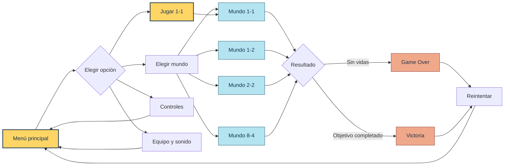
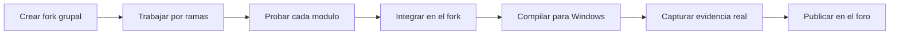

SUPER MARIO BROS 2D
AVENTURA UNIVERSITARIA · HITO 4
Multimedia y Videojuegos · Ingeniería de Sistemas · UNIFRANZ La Paz · Gestión 2026

UNITY 6   C#   2D PIXEL ART   4 MUNDOS   4 INTEGRANTES   TRABAJO GRUPAL

EXPLORAR LOS MUNDOS · EQUIPO · CÓMO JUGAR · INSTALAR · ENTREGA

DEL MENÚ A LA VICTORIA — RECORRIDO ANIMADO

Animación ORIGINAL diseñada para el README. No es una captura del Editor ni demuestra funcionalidades de Unity.
 
 
[ABRIR MAQUETA INTERACTIVA](VISTA_INTERACTIVA.html) · REPOSITORIO DEL PROYECTO

Para probar los botones y transiciones, descarga el repositorio y abre VISTA_INTERACTIVA.html en tu navegador. GitHub muestra el archivo fuente, no ejecuta la página dentro del README.

[!IMPORTANT]
Estado: integración grupal en curso. En el main consultado existen los mundos 1-1, 1-2, 2-2, 8-4, GameOver y Victory. El menú inicial del Hito 4 y la verificación del HUD (tiempo/puntos/monedas) requieren pruebas en el fork del equipo. Las imágenes son conceptuales y las contribuciones asignadas no implican que todo esté validado.

El proyecto de un vistazo
<table>
<tr>
<td align="center"><strong>04</strong> MUNDOS</td>
<td align="center"><strong>04</strong> INTEGRANTES</td>
<td align="center"><strong>06</strong> ESCENAS EXISTENTES</td>
<td align="center"><strong>06</strong> SFX A COMPROBAR*</td>
</tr>
</table>* La consigna exige sonidos de salto, pisotón, power-up, daño y muerte, además de sonido ambiente; se detallan las verificaciones más adelante.

Ruta de lectura: 01 · Mundos / 02 · Flujo / 03 · Equipo / 04 · Controles / 05 · Audio y HUD / 06 · Instalación / 07 · Entrega / 08 · Créditos

01 / ELIGE TU MUNDO
Haz clic en las tarjetas ilustradas para ver los detalles técnicos de cada nivel.
<table>
<tr>
<td width="50%" align="center">

 <strong>1-1 · PRADERA</strong> Escenario base / plataformas
</td>
<td width="50%" align="center">

 <strong>1-2 · SUBTERRÁNEO</strong> Túneles / obstáculos
</td>
</tr>
<tr>
<td align="center">

 <strong>2-2 · ACUÁTICO</strong> Carla / natación
</td>
<td align="center">

 <strong>8-4 · CASTILLO FINAL</strong> Marcelo / desafío final
</td>
</tr>
</table>

<strong>1-1 · PRADERA — Detalles del nivel inicial</strong>

Entrada al juego con desplazamiento, saltos, enemigos, bloques y monedas. Escena Assets/Scenes/1-1.unity.

<strong>1-2 · SUBTERRÁNEO — Detalles del nivel</strong>

Escenario de rutas bajo tierra, obstáculos y música de ambiente. Escena Assets/Scenes/1-2.unity; generador Assets/Editor/UndergroundLevelBuilder.cs.

<strong>2-2 · ACUÁTICO — Detalles del nivel de Carla</strong>

Natación, gravedad adaptada, fauna submarina y burbujas. Escena Assets/Scenes/2-2.unity; scripts WaterZone.cs, WaterEnemy.cs y PlayerMovement.cs. Responsable grupal: Carla.

<strong>8-4 · CASTILLO FINAL — Detalles del nivel de Marcelo</strong>

Lava, trampas, mecánicas del jefe y final de la aventura. Escena Assets/Scenes/8-4.unity; scripts Boss.cs, BossArena.cs y CastleLevelBuilder.cs. Responsable grupal: Marcelo.

02 / UNA AVENTURA, DE PRINCIPIO A FIN
La secuencia siguiente es el flujo objetivo del menú grupal, no una certificación de que cada conexión ya esté probada.

<strong>Explorar las pantallas de la interfaz</strong>
Pantalla	Acción del jugador	Resultado previsto
Menú principal	Jugar / mundos / instrucciones	Navegación clara por teclado y ratón.
Seleccionar nivel	Elegir 1-1, 1-2, 2-2 o 8-4	Carga directa de la escena.
Cómo jugar	Consultar movimiento, salto y natación	Guía breve con retorno.
Créditos	Abrir el equipo	Nombres y módulos de los cuatro estudiantes.
Sonido	Alternar o ajustar volumen	Feedback visual y audible.
En partida	Recoger monedas, vencer enemigos, avanzar	Cambios en HUD y efectos de sonido.
Pausa / Game Over / Victoria	Retomar, reintentar o salir	Continuidad sin bloqueos.

03 / QUIÉN HACE QUÉ

<table>
<tr><th>INTEGRANTE</th><th>APORTE DEL HITO 4</th></tr>
<tr><td><strong>Marcelo Josué Escobar Chipana</strong></td><td>Castillo, obstáculos y último nivel <code>8-4</code>.</td></tr>
<tr><td><strong>Víctor Grover Asturizaga Plata</strong></td><td>Menús, navegación, sonido ambiente y SFX.</td></tr>
<tr><td><strong>Vicente Óscar Claros Mamani</strong></td><td>Pantalla y sistema de vidas; canciones y pantalla de victoria.</td></tr>
<tr><td><strong>Carla Valeria Encinas Cano</strong></td><td>Nivel acuático <code>2-2</code>, natación y entorno submarino.</td></tr>
</table>

<strong>Detalle técnico: Marcelo y el castillo</strong>
Archivos relacionados: Assets/Scenes/8-4.unity, Assets/Scripts/Boss.cs, BossArena.cs, Assets/Prefabs/Castle/. 

Por verificar: completar el recorrido sin bloqueos, comprobar peligros, condiciones de victoria y transición al final. La existencia de la escena no demuestra que todas esas pruebas ya se aprobaron.

<strong>Detalle técnico: Víctor y los menús / sonidos</strong>

Objetivo: integrar MenuPrincipal.unity con el selector de mundos, guía de juego, créditos y sonido. Base técnica existente: ChiptuneSynth.cs, Sfx.cs y LevelMusic.cs.

Por verificar: entrada desde Build Profiles, enlaces de botones, sonidos de salto/pisotón/power-up/daño/muerte y música ambiental; registrar evidencia real del Editor.

<strong>Detalle técnico: Vicente, vidas y victoria</strong>

Archivos relacionados: Assets/Scripts/GameManager.cs, GameOverScreen.cs, VictoryScreen.cs, VictoryGoal.cs, Assets/Scenes/GameOver.unity y Victory.unity.

Por verificar: descuento correcto de vidas, Game Over, música de victoria, estadísticas finales y botones de reinicio/regreso.

<strong>Detalle técnico: Carla y el nivel acuático</strong>

Archivos relacionados: Assets/Scenes/2-2.unity, WaterLevelBuilder.cs, WaterZone.cs, WaterEnemy.cs, PlayerMovement.cs, Assets/Prefabs/Water/.

Por verificar: entrada y salida del agua, natación, burbujas, enemigos acuáticos, obstáculos y salida del nivel.

04 / APRENDE A JUGAR
MOVIMIENTO	TECLA	MECÁNICA
Izquierda / derecha	A D / ← →	Desplazamiento horizontal.
Saltar	ESPACIO	Superar obstáculos y enemigos.
Nadar	ESPACIO	Impulsos sucesivos dentro del agua.
Entrar en tubería	S	Tuberías habilitadas.
Salida lateral	D	Interacciones que lo permitan.

Tipografía propuesta para la interfaz: títulos con estética pixel art y contenido con fuentes sans serif de alta legibilidad. Pixelify Sans es una referencia visual opcional para Unity; el README y la demo no necesitan descargarla para mostrarse. Se recomienda limitar la tipografía retro a títulos y botones y mantener explicaciones claras y alineadas.

05 / HUD Y SONIDO: LO QUE HAY Y LO QUE FALTA

Visualización de referencia, no captura de contadores implementados.

<strong>Sistema de audio</strong>
El repositorio contiene ChiptuneSynth.cs, Sfx.cs y LevelMusic.cs; hay clips sintetizados de salto, pisotón, power-up, muerte, natación, música acuática, castillo y victoria. Pendiente: escuchar y verificar cada evento solicitado en su escena, especialmente el SFX de daño.

<strong>Vidas, monedas, puntaje y tiempo</strong>
- Vidas: GameManager.cs establece tres vidas y controla el final de partida.
- Monedas: GameManager.AddCoin() lleva el conteo y concede vida extra cada cien monedas.
- Puntaje: se requiere verificar o implementar la suma por monedas y enemigos y mostrarla en el HUD.
- Tiempo: se requiere verificar o implementar un temporizador visible por nivel.
Los valores del gráfico son ejemplos de diseño, no lecturas reales de una partida.

06 / INSTALACIÓN EN 3 PASOS

<strong>PASO 01 — Clonar el proyecto</strong>
Requiere Unity Hub, Unity 6 6000.3.16f1 y Git.
git clone https://github.com/vicentesystemdev/SuperMarioVicente.git
cd SuperMarioVicente

<strong>PASO 02 — Abrir y ejecutar una escena</strong>
1. En Unity Hub selecciona Add project from disk y abre la carpeta clonada.
2. Confirma la versión 6000.3.16f1.
3. Abre Assets/Scenes/1-1.unity y pulsa Play para comprobar el proyecto existente.
4. Comprueba las otras escenas desde Assets/Scenes/.

<strong>PASO 03 — Integrar el menú y exportar</strong>
1. Incorpora el trabajo de Víctor (MenuPrincipal.unity) al fork grupal.
2. Configura File > Build Profiles > Scene List, con el menú en índice 0 y niveles habilitados.
3. Verifica cada botón, audio, contador y transición con Play.
4. Compila para Windows y prueba el .exe junto a su carpeta *_Data.
Esta documentación no instala ni modifica el proyecto Unity automáticamente.

07 / TRABAJO GRUPAL Y ENTREGA

<strong>Lista de revisión del Hito 4</strong>
- [ ] El menú aparece al iniciar el juego.
- [ ] Jugar y seleccionar nivel funcionan.
- [ ] Música de fondo y SFX de salto, pisotón, power-up, daño y muerte están probados.
- [ ] El HUD muestra tiempo, monedas y puntaje de forma coherente.
- [ ] La puntuación suma monedas y enemigos eliminados.
- [ ] Se puede completar el nivel acuático y el castillo.
- [ ] Las vidas, Game Over, canción de victoria y reinicio funcionan.
- [ ] El ejecutable Windows inicia correctamente fuera de Unity.
- [ ] El fork grupal es público y cada integrante publica captura real de Unity, dificultad, solución y su aporte favorito.
Estas casillas no están marcadas como completadas porque requieren pruebas del grupo.

<strong>Git: trabajo por ramas</strong>
git switch -c feature/hito4-mi-modulo
# Agrega y prueba tu aporte
git add Assets/ README.md Docs/
git commit -m "feat(hito4): integrar modulo grupal"
git push -u origin feature/hito4-mi-modulo
Usa una rama nueva y abre un pull request al fork del grupo; no reemplaces main sin revisión.

08 / CRÉDITOS Y LICENCIAS
Este es un trabajo académico grupal no comercial basado en un proyecto preexistente. La autoría del grupo corresponde a sus aportes, no al código completo ni a todos los recursos originales.

Fuentes de referencia: SuperMarioVicente · Jesusbautistah/SUPER-MArio · Zigurous Unity Mario Tutorial. Super Mario Bros, Mario y los personajes y materiales originales asociados pertenecen a Nintendo y a sus titulares. La referencia pública no equivale a una licencia de reutilización.

El arte para este README (Docs/Media) se diseñó específicamente como material conceptual. No sustituye las capturas reales que exige el docente.

CUATRO APORTES. UNA MISMA AVENTURA.

Marcelo Josué Escobar Chipana · Víctor Grover Asturizaga Plata
Vicente Óscar Claros Mamani · Carla Valeria Encinas Cano

Volver al inicio · Explorar mundos · [Demostración local](VISTA_INTERACTIVA.html)

